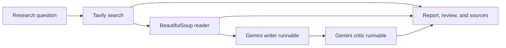

# ResearchMind

**A source-first AI research studio built with Gemini, Tavily, LangChain, and Streamlit.**

ResearchMind turns a research question into a readable brief by finding live web sources, extracting page text, drafting a report, and running a separate review pass. Search results and scraped notes remain available alongside the report so readers can inspect the evidence trail.

## What it demonstrates

- **Multi-step AI workflow:** purpose-specific search and reader agents, followed by LCEL writer and critic runnables.
- **Tool integration:** Tavily search and BeautifulSoup page extraction are exposed as LangChain tools.
- **Faster execution path:** Quick mode calls search and scraping directly, avoiding extra Gemini tool-selection calls.
- **Source-aware output:** report prompts ask Gemini to ground findings in the returned material and include source URLs.
- **Usable delivery:** Streamlit progress, separate report/review/source views, and Markdown export.

## Workflow



Quick mode is enabled by default. Turn it off in the app to use the Gemini search and reader agents, which decide when to call their tools.

## Run locally

### 1. Configure API keys

Copy `.env.example` to `.env` and add your keys:

```dotenv
GEMINI_API_KEY=your_gemini_api_key
TAVILY_API_KEY=your_tavily_api_key
GEMINI_MODEL=gemini-3.8-flash
```

Keep `.env` private. Do not commit API keys.

### 2. Install dependencies

From PowerShell in the project folder:

```powershell
uv venv .venv
.\.venv\Scripts\Activate.ps1
uv pip install -r requirements.txt
```

If `uv` is not installed, use Python's built-in virtual environment and pip:

```powershell
py -m venv .venv
.\.venv\Scripts\Activate.ps1
python -m pip install -r requirements.txt
```

### 3. Launch the app

```powershell
streamlit run app.py
```

The command-line workflow is also available:

```powershell
python pipeline.py
```

## Deploy on Streamlit Community Cloud

Streamlit Community Cloud can deploy directly from a GitHub repository. The project reads credentials from either local environment variables or Streamlit secrets.

1. Push this project to a GitHub repository. Keep `.env` and `.streamlit/secrets.toml` out of Git; they are ignored by `.gitignore`.
2. Sign in at [Streamlit Community Cloud](https://share.streamlit.io/) with GitHub and create an app.
3. Choose the repository, the `main` branch, and `app.py` as the entrypoint.
4. In **Advanced settings → Secrets**, add the following TOML, replacing the placeholders with your own API keys:

   ```toml
   GEMINI_API_KEY = "your_gemini_api_key"
   TAVILY_API_KEY = "your_tavily_api_key"
   GEMINI_MODEL = "gemini-3.8-flash"
   ```

5. Select Python 3.12 if asked, then deploy.

The deployment uses the root `requirements.txt` and `.streamlit/config.toml`. Never paste keys into Python files, commit them to GitHub, or include real keys in screenshots. For deployment troubleshooting, check the app logs in the Community Cloud workspace.

## Project structure

| File | Responsibility |
| --- | --- |
| `app.py` | Streamlit product interface, progress, report views, and Markdown export |
| `tools.py` | Tavily web search and public-page text extraction |
| `agents.py` | Gemini model, tool-using agents, and LCEL report runnables |
| `pipeline.py` | Search → reader → writer → critic orchestration |
| `requirements.txt` | Python project dependencies |
| `.env.example` | Environment variable template |

## Design notes

- Quick mode uses three Tavily results and scrapes the top returned URL. Agent mode delegates source selection to the reader agent.
- Search and scraping use network requests and have timeouts. Some publishers block automated page reads; the search snippets remain available when that happens.
- Gemini and Tavily apply their own quotas, rate limits, and account policies.
- Model selection is configurable through `GEMINI_MODEL`.

## Next improvements

- Add citation validation and source publication dates to the final brief.
- Add retry and fallback handling when the top search result cannot be scraped.
- Add saved research history and export formats beyond Markdown.
